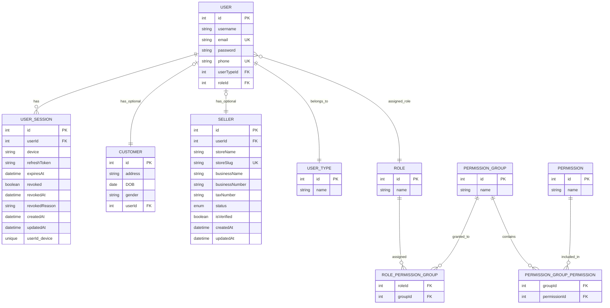

# Authentication & Authorization in E-Commerce Applications

# Table of Contents

- [Introduction](#introduction)

- [Registration](#registration)

- [Authentication](#authentication)

- [Authorization](#authorization)

- [ERD](#erd)

---

# Introduction

This repository explains the complete flow of authentication and authorization in E-Commerce applications, starting from user registration up to implementing Role-Based Access Control (RBAC).

## Main Processes

1. Registration
2. Authentication
3. Authorization

---

# Registration

It is the process of enabling individuals to become users of the system. Since the system supports multiple user types with different roles and interactions, it provides a dedicated registration method for each user category.

| User Type              | Registration Method                        |
| :--------------------- | :----------------------------------------- |
| Customer               | Registers using the application UI         |
| Seller                 | Registers using the application UI         |
| Super Admin            | Created by seeders                         |
| Admin                  | Created by the system owner or super admin |
| Customer Support Agent | Created by admin                           |

For more details, refer to the following file:

- [User Registration Documentation](./server/docs/registeration.md)
- [OTP Documentation](./server/docs/OTP.md)

---

# Authentication

Is the process by which the system verifies whether a user attempting to access the application has a valid account.

There are two common authentication approaches:

1. **Passwordless Authentication**  
   Uses an email address or phone number along with OTP verification to authenticate the user.

2. **Password-Based Authentication**  
   Uses an email address or phone number combined with a password for user verification.

For more details, refer to:  
[Passwordless vs. Password-Based App](./server/docs/registeration.md#4-passwordless-vs-password-based-app)

In this application, we will implement the **Password-Based Authentication** approach.

## Unified User Authentication Model

After completing the registration process, every user in the system must have:

- Email
- Password

These credentials will be used during the login process.

After a successful login, the system generates a **JWT access token** and a **refresh token**. These tokens are used to authenticate requests to other API routes, providing a seamless user experience where users can remain authenticated for a defined period without needing to log in repeatedly.

For more details, refer to the following file:

- [User Authentication Documentation](./server/docs/authentication.md)

---

# Authorization

Is the process of checking if authenticated user has the right to access specific api routes/resources or not, based on his ownership or role.

## Authorization Strategy

Authorization is enforced entirely at the backend/server level to ensure strong security and prevent any client-side manipulation.

After successful JWT/session authentication, the system applies two different authorization strategies based on the user type.

### 1. Customer Authorization Strategy

For customers, authorization is based on ownership/resource validation.

The system verifies that the authenticated customer is accessing only resources that belong to him, such as:

- Orders
- Cart
- Addresses
- Payments
- Wishlist

Example:

- A customer can access his own order
- A customer cannot access another customer's order

### 2. Dashboard User Authorization Strategy

For dashboard users, authorization is based on Role-Based Access Control (RBAC) and permission checks.

After authentication, the system validates:

1. User role
2. Assigned permissions
3. Allowed dashboard actions

Examples:

- `SUPER_ADMIN` can manage the whole system
- `ADMIN` can manage operational data
- `CUSTOMER_SUPPORT` can handle support tickets only
- `SELLER` can manage their products/orders only

For more details, refer to the following file:

- [User Authorization Documentation](./server/docs/authorization.md)

---

# General Flowchart 

# ERD
