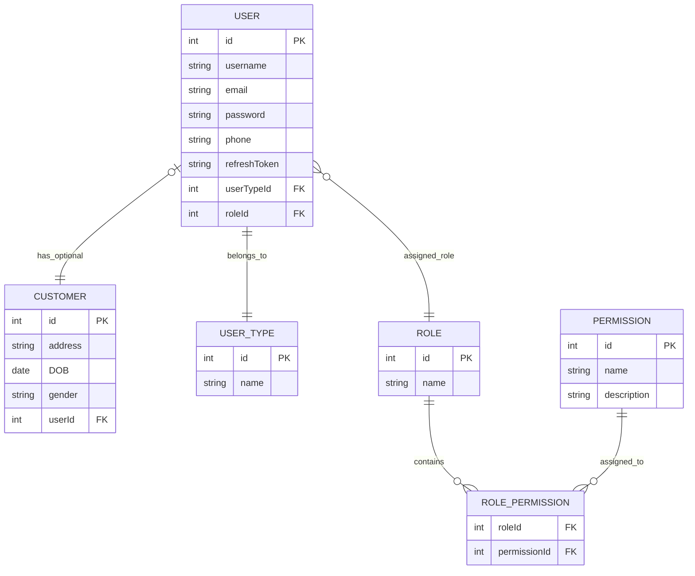

# Authentication & Authorization in E-Commerce Applications

This repository explains the complete flow of authentication and authorization in E-Commerce applications, starting from user registration up to implementing Role-Based Access Control (RBAC).

---

# Main Processes

The system is divided into three main processes:

1. Registration
2. Authentication
3. Authorization

---

# User Types in E-Commerce Applications

E-Commerce systems usually contain two main categories of users:

## 1. Customer

The main user of the platform who can:

- Browse products
- Place orders
- Make payments
- Track deliveries

## 2. Dashboard Users

Users who manage and operate the system, including:

- Super Admin
- Admin
- Customer Support Agent
- Sellers / Service Providers
---

# Registration Flow

Each user type has its own registration or creation flow:

| User Type | Registration Method |
|:--|:--|
| Customer | Registers using the application UI |
| Seller | Registers using the application UI |
| Admin | Created by the system owner or super admin |
| Customer Support Agent | Created by admin |

---

# Unified User Authentication Model

All users in the system must have:

- Username or Email
- Password

Since all users authenticate into the system, they are stored inside a unified `User` model.

The `User` model contains a `type` field that determines whether the user is:

- `CUSTOMER`
- `DASHBOARD_USER`

---

# Roles for Dashboard Users

Dashboard users are assigned specific roles to control permissions and access levels within the system.

Available roles include:

- `SUPER_ADMIN`
- `ADMIN`
- `CUSTOMER_SUPPORT`
- `SELLER`

---
# Permission Design Strategy

Permissions are organized into **Permission Groups** based on business responsibilities rather than database structure or CRUD operations. This keeps the authorization model aligned with real business domains, making it easier to understand, maintain, and scale.

Each permission group represents a core business area such as:

- Customer Service & Support
- Catalog Management
- Inventory Management
- Order Management
- Marketing & Customer Retention
- User & Access Management
- System Administration

Permissions should always be placed in the group that owns the corresponding business capability.

---

## Benefits

- Groups permissions by business function instead of technical structure
- Makes role assignment clearer and easier to manage
- Improves system maintainability as it grows
- Reduces duplication of permissions
- Simplifies onboarding for developers and administrators
- Allows new business domains to be added without redesigning RBAC

---

## Permission Naming Convention

All permissions follow a consistent pattern:

```text
resource.action
```

Examples:

```text
product.create
product.update
order.refund
ticket.close
seller.approve
user.assign_role
```

---

## Extensibility

New business features are introduced by adding new permission groups without changing the existing structure or naming convention.

This ensures the RBAC model remains scalable and consistent over time:

```text
Role
    ↓
Permission Group
    ↓
Permission
```

Roles are assigned permission groups, and groups contain the actual permissions enforced by the authorization layer.

---

# Permissions

## Customer Service & Support

Permissions related to helping customers and resolving issues.

- customer.read
- customer.update
- ticket.create
- ticket.read
- ticket.reply
- ticket.assign
- ticket.close
- ticket.reopen
- review.read
- review.moderate

Typical Roles:
- CUSTOMER_SUPPORT
- ADMIN

---

## Customer Management

Permissions related controlling customer accounts

- customer.read
- customer.delete
- customer.block
- customer.unblock

--- 
## Seller Management

Permissions related to onboarding and managing sellers.

- seller.read
- seller.approve
- seller.delete
- seller.update
- seller.suspend

Typical Roles:
- ADMIN
- SUPER_ADMIN

---

## Catalog Management

Permissions related to managing products and the shopping catalog.

- product.create
- product.read
- product.update
- product.delete
- product.publish
- product.unpublish
- category.create
- category.read
- category.update
- category.delete


Typical Roles:
- SELLER
- ADMIN

---

## Inventory Management

Permissions related to stock management.

- inventory.read
- inventory.update
- inventory.adjust

Typical Roles:
- SELLER
- ADMIN

---

## Order Management

Permissions related to order processing and fulfillment.

- order.read
- order.update
- order.cancel
- order.refund
- order.complete

Typical Roles:
- SELLER
- ADMIN
- CUSTOMER_SUPPORT

---

## Payment Management

Permissions related to payment operations.

- payment.read
- payment.refund
- payment.cancel

Typical Roles:
- ADMIN

---

## Marketing & Customer Retention

Permissions related to discounts, promotions, and loyalty programs.

### Coupons

- coupon.create
- coupon.read
- coupon.update
- coupon.delete
- coupon.activate
- coupon.deactivate

### Promotions

- promotion.create
- promotion.read
- promotion.update
- promotion.delete

### Loyalty Programs

- loyalty.read
- loyalty.adjust
- loyalty.revoke

Typical Roles:
- ADMIN

---

## Notification Management

Permissions related to notification

- notification.read
- notification.send
- notification.delete

---
## Reporting & Analytics

Permissions related to business insights and reporting.

- report.read
- report.export
- analytics.read

Typical Roles:
- ADMIN
- SUPER_ADMIN

---

## User & Access Management

Permissions related to system users, roles, and permissions.

### Users

- user.create
- user.read
- user.update
- user.delete
- user.activate
- user.deactivate

### Roles

- role.create
- role.read
- role.update
- role.delete
- role.assign

### Permissions

- permission.read
- permission.assign

Typical Roles:
- ADMIN
- SUPER_ADMIN

---

## Audit & Compliance

Permissions related to auditing and compliance tracking.

- audit.read
- audit.export

Typical Roles:
- SUPER_ADMIN

---

## System Administration

Permissions related to configuring and maintaining the platform.

- settings.read
- settings.update
- system.backup
- system.restore


### Super Permission Management

- permission.create
- permission.update
- permission.delete
  
Typical Roles:
- SUPER_ADMIN

---

## Full System Access
- system.admin
  
Typical Roles:
- SUPER_ADMIN


# Authorization Strategy

Authorization is enforced entirely at the backend/server level to ensure strong security and prevent any client-side manipulation.

After successful JWT/session authentication, the system applies two different authorization strategies based on the user type.

---

## 1. Customer Authorization Strategy

For customers, authorization is based on ownership/resource validation.

The system verifies that the authenticated customer is accessing only resources that belong to them, such as:

- Orders
- Cart
- Addresses
- Payments
- Wishlist

Example:

- A customer can access their own order
- A customer cannot access another customer's order

This type of authorization is commonly known as:

- Ownership Validation or
- Resource-Based Authorization

---

## 2. Dashboard User Authorization Strategy

For dashboard users, authorization is based on Role-Based Access Control (RBAC) and permission checks.

After authentication, the system validates:

1. User role
2. Assigned permissions
3. Allowed dashboard actions

Examples:

- `SUPER_ADMIN` can manage the whole system
- `ADMIN` can manage operational data
- `CUSTOMER_SUPPORT` can handle support tickets
- `SELLER` can manage their products/orders
- `DELIVERY_DRIVER` can access delivery-related operations only

---
# ERD



