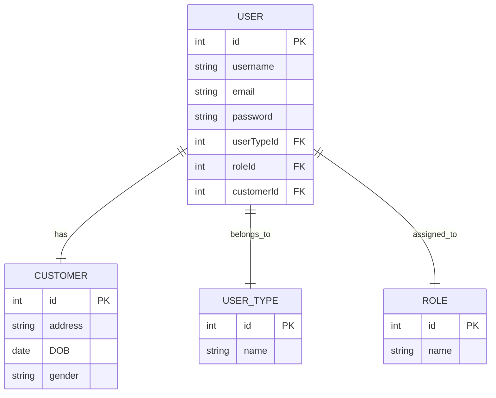

# Authentication-and-Authorization-in-Node-Js
In this repo, I explain how whole process of authentication and authorization flows, starting from registration till RBAC in E-Commerce apps

There are three main processes
1- Registragtion 
2- Authentication
3- Authorization

In E-commerce applications, there are two different types of users
1- Customer: who is the main user of the system
2- Dashboard Users: include super admin(optional), admin/s, customer support agent, service prodivers(sellers) and Delivery Driver

each user has its own registration method:
1- customer: use UI interface
2- seller: use UI interface 
3- delivery driver: use UI interface
5- admin: added by system owner
6- customer support agent : added by admin

all these users must have username/email and password to login----> so all are inserted in user model
and the type will be either customer or dashboard_user
then the roles will be assigned to dashboard users as the following:
Super_Admin
Admin
Customer_Support
Seller
Delivery_Driver

# Authentication & Authorization in E-Commerce Applications

This repository explains the complete flow of authentication and authorization in E-Commerce applications, starting from user registration up to implementing Role-Based Access Control (RBAC).

---

# Main Processes

The system is divided into three main processes:

1. Registration
2. Authentication
3. Authorization

---

# User Types in E-Commerce Applications

E-Commerce systems usually contain two main categories of users:

## 1. Customer

The main user of the platform who can:

- Browse products
- Place orders
- Make payments
- Track deliveries

## 2. Dashboard Users

Users who manage and operate the system, including:

- Super Admin (optional)
- Admin
- Customer Support Agent
- Sellers / Service Providers
- Delivery Drivers

---

# Registration Flow

Each user type has its own registration or creation flow:

| User Type | Registration Method |
|---|---|
| Customer | Registers using the application UI |
| Seller | Registers using the application UI |
| Delivery Driver | Registers using the application UI |
| Admin | Created by the system owner or super admin |
| Customer Support Agent | Created by admin |

---

# Unified User Authentication Model

All users in the system must have:

- Username or Email
- Password

Since all users authenticate into the system, they are stored inside a unified `User` model.

The `User` model contains a `type` field that determines whether the user is:

- `CUSTOMER`
- `DASHBOARD_USER`

---

# Roles for Dashboard Users

Dashboard users are assigned specific roles to control permissions and access levels within the system.

Available roles include:

- `SUPER_ADMIN`
- `ADMIN`
- `CUSTOMER_SUPPORT`
- `SELLER`
- `DELIVERY_DRIVER`

---

# Authorization Strategy

The system uses Role-Based Access Control (RBAC) to manage permissions.

Authorization is enforced at the backend/server level to ensure security and prevent client-side manipulation.

The authorization flow typically includes:

1. Authentication using JWT/session
2. Role validation
3. Ownership/resource validation
4. Permission checks

---

# Security Goals

This project focuses on implementing secure backend practices such as:

- JWT Authentication
- Secure password hashing
- RBAC authorization
- Ownership validation
- Protected dashboard routes
- Customer resource protection
- Secure admin creation flow
- Prevention of unauthorized access

