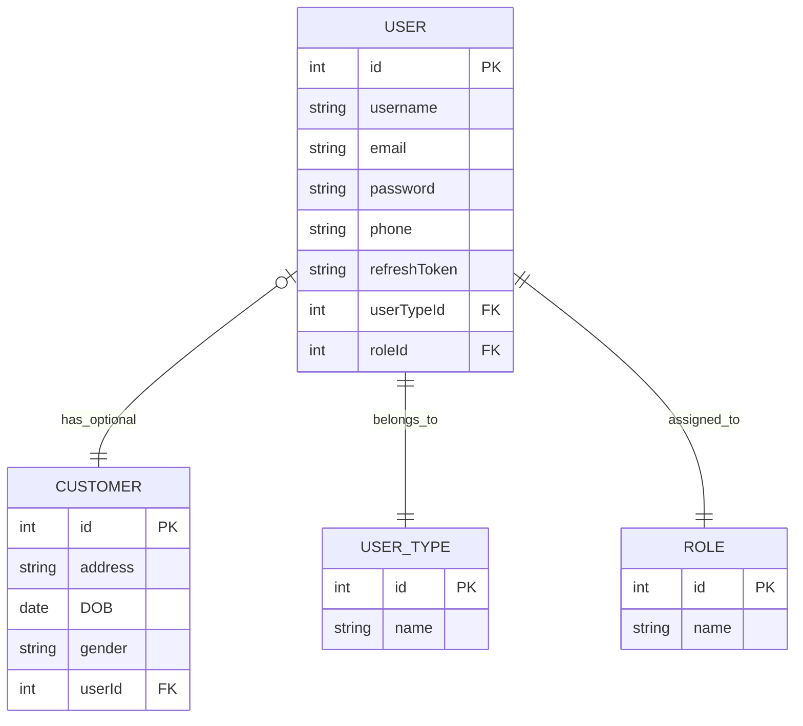

# Authentication & Authorization in E-Commerce Applications

This repository explains the complete flow of authentication and authorization in E-Commerce applications, starting from user registration up to implementing Role-Based Access Control (RBAC).

---

# Main Processes

The system is divided into three main processes:

1. Registration
2. Authentication
3. Authorization

---

# User Types in E-Commerce Applications

E-Commerce systems usually contain two main categories of users:

## 1. Customer

The main user of the platform who can:

- Browse products
- Place orders
- Make payments
- Track deliveries

## 2. Dashboard Users

Users who manage and operate the system, including:

- Super Admin (optional)
- Admin
- Customer Support Agent
- Sellers / Service Providers
- Delivery Drivers

---

# Registration Flow

Each user type has its own registration or creation flow:

| User Type | Registration Method |
|---|---|
| Customer | Registers using the application UI |
| Seller | Registers using the application UI |
| Delivery Driver | Registers using the application UI |
| Admin | Created by the system owner or super admin |
| Customer Support Agent | Created by admin |

---

# Unified User Authentication Model

All users in the system must have:

- Username or Email
- Password

Since all users authenticate into the system, they are stored inside a unified `User` model.

The `User` model contains a `type` field that determines whether the user is:

- `CUSTOMER`
- `DASHBOARD_USER`

---

# Roles for Dashboard Users

Dashboard users are assigned specific roles to control permissions and access levels within the system.

Available roles include:

- `SUPER_ADMIN`
- `ADMIN`
- `CUSTOMER_SUPPORT`
- `SELLER`
- `DELIVERY_DRIVER`

---

# Authorization Strategy

Authorization is enforced entirely at the backend/server level to ensure strong security and prevent any client-side manipulation.

After successful JWT/session authentication, the system applies two different authorization strategies based on the user type.

---

## 1. Customer Authorization Strategy

For customers, authorization is based on ownership/resource validation.

The system verifies that the authenticated customer is accessing only resources that belong to them, such as:

- Orders
- Cart
- Addresses
- Payments
- Wishlist

Example:

- A customer can access their own order
- A customer cannot access another customer's order

This type of authorization is commonly known as:

- Ownership Validation
- Resource-Based Authorization

---

## 2. Dashboard User Authorization Strategy

For dashboard users, authorization is based on Role-Based Access Control (RBAC) and permission checks.

After authentication, the system validates:

1. User role
2. Assigned permissions
3. Allowed dashboard actions

Examples:

- `SUPER_ADMIN` can manage the whole system
- `ADMIN` can manage operational data
- `CUSTOMER_SUPPORT` can handle support tickets
- `SELLER` can manage their products/orders
- `DELIVERY_DRIVER` can access delivery-related operations only

---
# ERD

