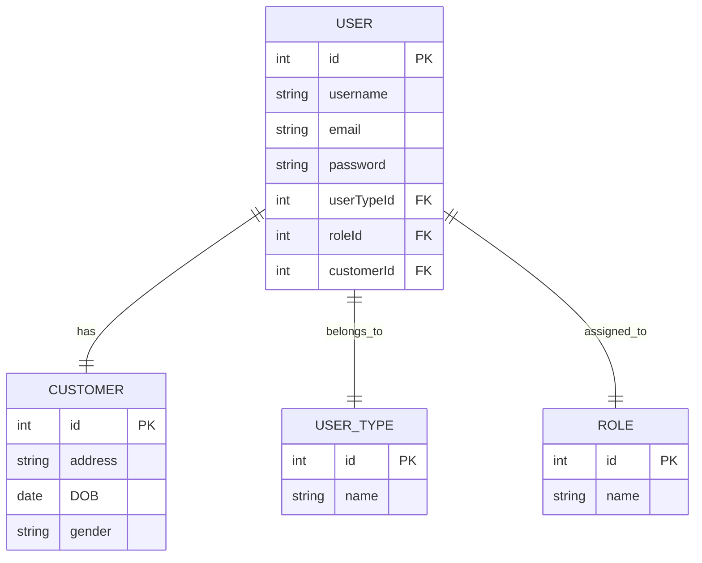

# Authentication-and-Authorization-in-Node-Js
In this repo, I explain how whole process of authentication and authorization flows, starting from registration till RBAC in E-Commerce apps

There are three main processes
1- Registragtion 
2- Authentication
3- Authorization

In E-commerce applications, there are two different types of users
1- Customer: who is the main user of the system
2- Dashboard Users: include super admin(optional), admin/s, customer support agent, service prodivers(sellers) and Delivery Driver

each user has its own registration method:
1- customer: use UI interface
2- seller: use UI interface 
3- delivery driver: use UI interface
5- admin: added by system owner
6- customer support agent : added by admin

all these users must have username/email and password to login----> so all are inserted in user model
and the type will be either customer or dashboard_user
then the roles will be assigned to dashboard users as the following:
Super_Admin
Admin
Customer_Support
Seller
Delivery_Driver

