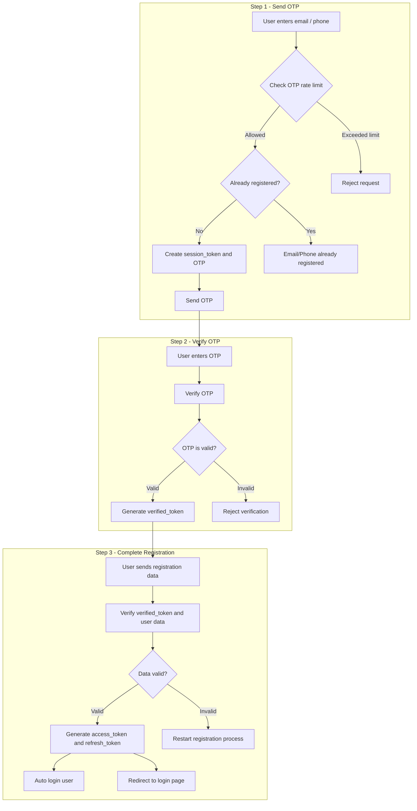

## Registration Flow with OTP 




### Rate Limit Window

is the time period in which OTP requests are counted. It responsible for count how many OTPs this email requested within the last 1 hour.

```js
if (count === 1) {
  await redis.expire(key, 3600);
}
```

We set '`expire` only on the FIRST request when `count === 1` because:
If we called `expire` every time, the window would keep sliding and never actually expire

#### Example of What happen at rate limit window

```
9:00  → OTP #1 → count: 1 → set expire 3600s → allowed ✅
9:05  → OTP #2 → count: 2 →                  → allowed ✅
9:10  → OTP #3 → count: 3 →                  → allowed ✅
9:15  → OTP #4 → count: 4 →                  → BLOCKED ❌ (key still lives, keeps incrementing)
10:00 → Redis deletes counter automatically
10:01 → OTP #1 → count: 1 → allowed again ✅
```

#### The Counter Keeps Incrementing Even After Block

This is intentional and works in your favor:

```
Attacker hammers endpoint with 1000 requests
→ counter reaches 1000
→ blocked on every single one
→ must wait full hour from first request
→ can't reset by stopping and starting again
```

### OTP Security Checklist

| Rule                                          | Why                                   |
| --------------------------------------------- | ------------------------------------- |
| Hash the OTP in Redis (bcrypt/SHA-256)        | So a Redis breach doesn't expose OTPs |
| Max 3 attempts, then invalidate               | Prevents brute force                  |
| OTP expires in 10 min                         | Limits attack window                  |
| Rate limit `/send-otp` (3 per hour per email) | Prevents OTP spam                     |
| `verified_token` is single-use                | Delete it after `/complete` succeeds  |
| Use 6-digit numeric OTP                       | Balance of security and UX            |

---

### How Long the Full Registration Takes

```
Step 1: Enter email + receive OTP
  → User has 10 minutes to enter the OTP (OTP session TTL = 600s)

Step 2: Enter OTP → get verified_token
  → User has 15 minutes to fill the profile form (verified_token TTL = 900s)

Step 3: Submit profile → account created

Total maximum time: 10 min + 15 min = 25 minutes
Realistic time: ~3–4 minutes
```

| Timer             | Current | Recommendation                    |
| ----------------- | ------- | --------------------------------- |
| OTP session       | 10 min  | Standard — Gmail/banks use 10 min |
| verified_token    | 15 min  | Fine for a short profile form     |
| Rate limit window | 1 hour  | Standard                          |

---

### API Endpoints Summary

| Step       | Endpoint                         | Input                            | Returns                         |
| ---------- | -------------------------------- | -------------------------------- | ------------------------------- |
| Register 1 | `POST /auth/register/send-otp`   | `email`                          |   `session_token`                 |
| Register 2 | `POST /auth/register/verify-otp` | `session_token`, `otp`           | `verified_token`                |
| Register 3 | `POST /auth/register/complete`   | `verified_token`, profile fields | `access_token`, `refresh_token` |
| Login 1    | `POST /auth/login/send-otp`      | `email`                          | `session_token`                 |
| Login 2    | `POST /auth/login/verify-otp`    | `session_token`, `otp`           | `access_token`, `refresh_token` |
| Protected  | `GET /user/me`                   | Bearer token                     | `user`                          |
