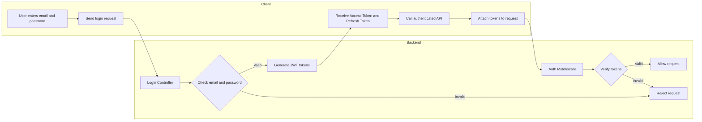
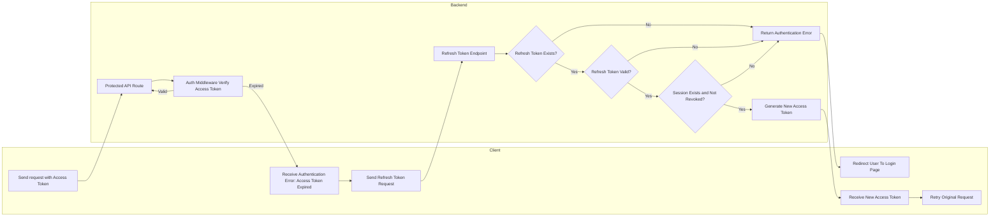
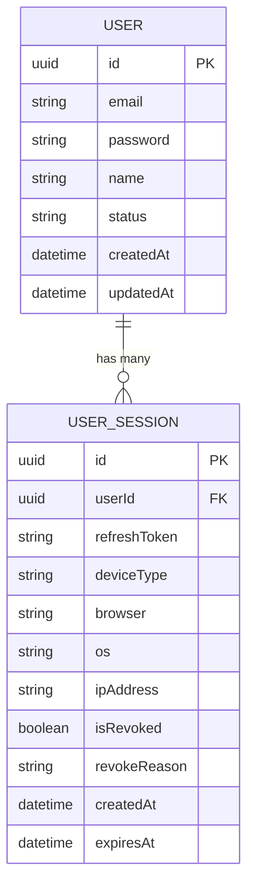
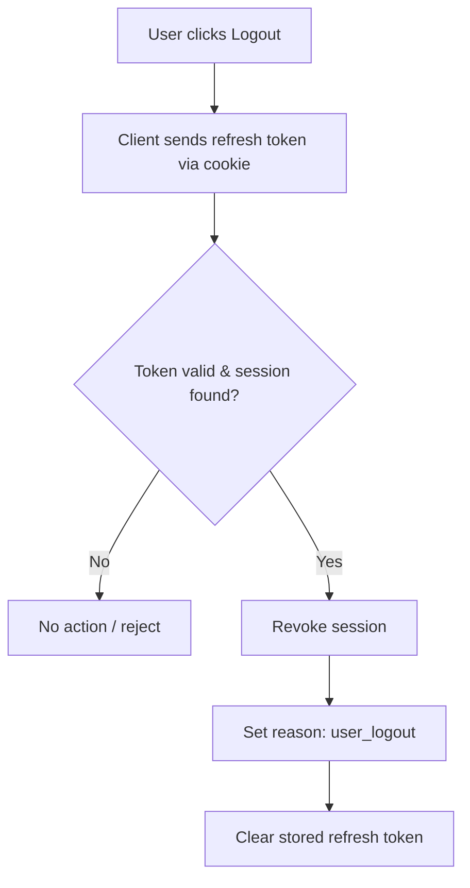
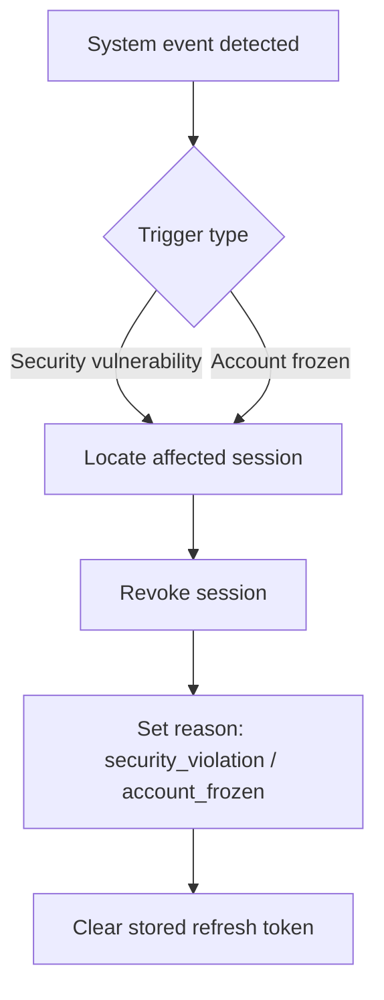
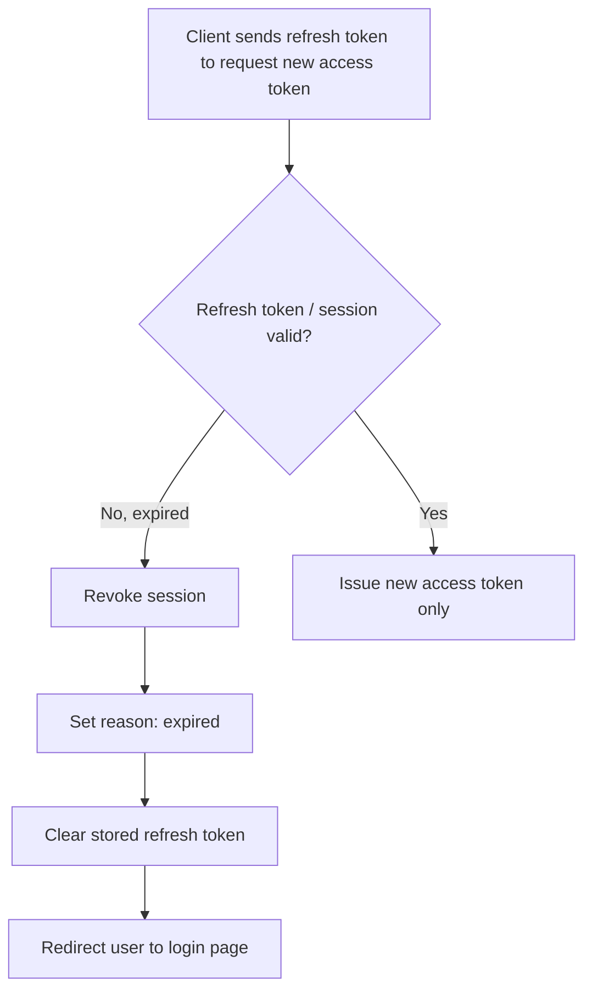
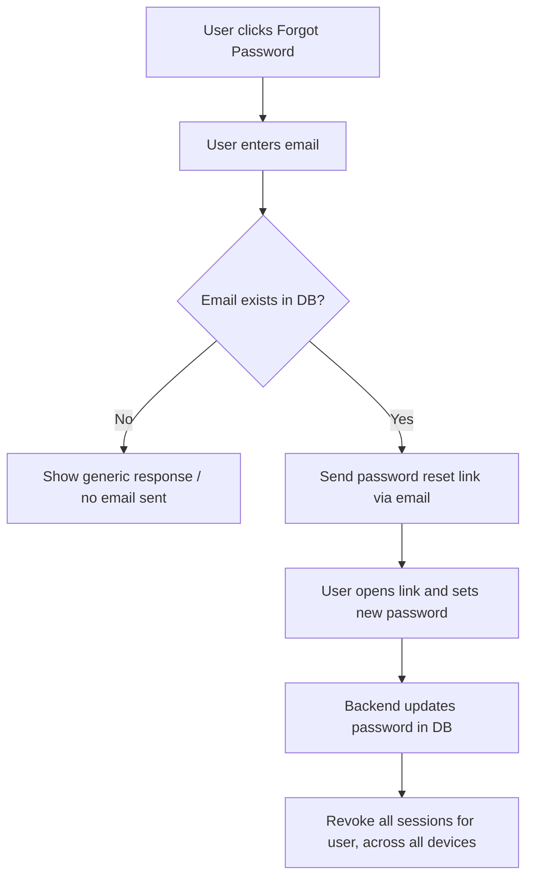

# Authentication Documentation

## Login flowchart



---

## Refresh Flowchart



---

## Access Token and Refresh Token

Both tokens are generated using a JWT library and used within the authentication process, but each serves a distinct function.

### A. Access Token

As the name implies, the access token is used to allow or deny access to specific API routes. It is sent with the HTTP request header and verified by the authentication middleware, so its payload must be designed to support that responsibility.

#### Payload Design Considerations

Choosing what to include in the access token payload involves several important considerations:

1. **Avoid sensitive data.** If the payload is not encrypted, it can be decoded easily on the frontend. It must never include sensitive data such as passwords or credit card details.

2. **Keep the payload minimal.** It should include only the information required for the application to function — serving both ends of the system:
   - **Frontend:** data needed for UI rendering, such as `username` (displayed in the navbar) and `role` (used to show/hide UI sections).
   - **Backend:** unique identifiers, such as `userId`, required for authentication and authorization checks.

#### Example

```js
const payload = {
  sub: user.id, // e.g. "user_9f3a1b2c"
  name: user.name, // e.g. "John"
  roles: user.roles, // e.g. ["admin", "editor"]
};

const accessToken = jwt.sign(payload, process.env.JWT_SECRET, {
  expiresIn: '15m', // short-lived
  issuer: 'api.myapp.com',
  audience: 'myapp.com',
  jwtid: crypto.randomUUID(),
});
```

### B. Refresh Token

The refresh token's role is to regenerate the access token once it expires, as long as the associated session is still alive and the refresh token itself has not expired. Because of this, its lifetime is significantly longer than the access token's — typically up to 30 days, depending on business requirements.

Its payload is also much simpler, containing only the session identifier (`sub: sessionId`), which is used to verify both the refresh token and the underlying session.

#### Example

```js
const payload = {
  sub: session.id,
};

const refreshToken = jwt.sign(payload, process.env.JWT_SECRET, {
  expiresIn: '30d', // long-lived
  issuer: 'api.myapp.com',
  audience: 'myapp.com',
  jwtid: crypto.randomUUID(),
});
```

---

## User Session Model: Purpose and Design Philosophy

### Overview

The User Session table is a core component of the authentication system. Its purpose is to manage and track user access across multiple devices in a way that is secure, scalable, and auditable.

Rather than storing a refresh token directly on the User model, this design introduces a dedicated session layer that represents each login instance as an independent entity.

---

### Why a Separate Session Table?

Users may access the system from multiple devices simultaneously (mobile, desktop, tablet). Supporting this is essential for a good user experience — particularly in applications like e-commerce platforms, where seamless multi-device access is expected.

To support this behavior, refresh tokens are stored in a dedicated **User Session** table rather than on the **User** model itself.

--- 

### What "Session" Means?

A session represents a single authenticated login instance. When a user successfully logs in, the system creates a session record that tracks that login's active presence until it becomes invalid (via revocation or expiration).

Each session record includes:

- **User identity** (`userId`)
- **Refresh token**
- **Device information** (device type, browser, OS)
- **Creation and expiration timestamps**
- **Status** (active / revoked) and, where applicable, a **revocation reason**

In this context, a session is a lifecycle record of authentication activity — not merely a token container.

---

### Why Not Store the Refresh Token on the User Model?

Storing the refresh token directly on the User model is simpler, but introduces several limitations:

| Limitation                       | Description                                                                                                                                                                                              |
| -------------------------------- | -------------------------------------------------------------------------------------------------------------------------------------------------------------------------------------------------------- |
| **Limited multi-device support** | A single token field implies one active session per user, which conflicts with multi-device login.                                                                                                       |
| **Poor separation of concerns**  | The User model should represent identity data, not authentication lifecycle behavior. Mixing the two leads to a bloated, less maintainable design.                                                       |
| **Weak auditability**            | A bare token field carries no history — it can't capture login history, device usage, or suspicious activity.                                                                                            |
| **Coarse-grained revocation**    | Freezing access means mutating the User record directly. There's no clean way to record _why_ access was revoked without adding audit-specific fields to a model that shouldn't own that responsibility. |

---

### Advantages of the Session-Based Approach

**Security control**
Each session can be independently revoked, invalidated, or monitored. If a refresh token is compromised, the corresponding session can be revoked without touching the User record — and even though the stolen token is technically still unexpired, it becomes unusable the moment its session is marked invalid. This removes the need to wait out the token's natural expiration window.

**Improved auditing and monitoring**
The session table can capture metadata such as device type, IP address, user agent, and revocation reason — enabling tracking of user behavior and detection of suspicious activity.

**Fine-grained session management**
The system can revoke a single device's session, revoke all sessions for a user, or track concurrent logins across devices.

---

### Summary

The User Session table is the system's source of truth for authentication state. It represents:

- User login activity
- Device-level authentication context
- Session validity and lifecycle
- Security control and revocation

This design improves **security**, **scalability**, **observability**, and **maintainability**, while enabling a better user experience across multiple devices.

---

## User and Session ERD



---

# Session Revocation

A session can be terminated before its natural expiration through **revocation**. Revocation is triggered either by the user directly, or by the system in response to specific conditions.

## Revocation Triggers

### 1. User-Initiated

| Trigger            | Description                                                                                                  |
| ------------------ | ------------------------------------------------------------------------------------------------------------ |
| **Logout**         | The user explicitly ends their own session.                                                                  |
| **Password Reset** | The user resets their password, which implicitly invalidates all existing sessions as a security precaution. |

### 2. System-Initiated

| Trigger                                | Description                                                                                                                                             |
| -------------------------------------- | ------------------------------------------------------------------------------------------------------------------------------------------------------- |
| **Security vulnerability**             | A detected threat (e.g., suspicious activity, credential leak) forces revocation of one or more sessions.                                               |
| **Account freezing**                   | An administrator or fraud-detection process disables a user's account, revoking all active sessions.                                                    |
| **Session / refresh token expiration** | Once the refresh token (or session) has actually expired, the system revokes the session and redirects the user to the login page to start a fresh one. |

> **Note:** Expiration is technically a _passive_ form of invalidation — the session simply lapses rather than being explicitly revoked. It's grouped here because, functionally, it produces the same end state: the session can no longer be used.

--- 

## Revocation Flows

### Logout Flow



--- 


### System-Initiated Revocation Flow

Covers security vulnerabilities and account freezing — admin- or system-triggered cases where a session is terminated independently of the user's activity.



--- 

### Refresh Token Verification Flow

Triggered whenever the client uses its refresh token to request a new access token.



---

### Password Reset Flow


