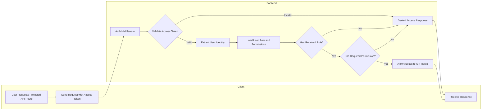
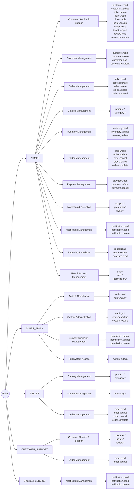

# Authorization Documentation

## RBAC Flowchart


## Roles, Permissions Groups and Permissions



## Permission Design Strategy

### why we use permission groups instead of assigning permissions to roles directly?

We organized permissions into **Permission Groups** based on business responsibilities rather than database structure or CRUD operations. This keeps the authorization model aligned with real business domains, making it easier to understand, maintain, and scale.

So each permission group represents a core business area such as:

- Customer Service & Support
- Catalog Management
- Inventory Management
- Order Management
- Marketing & Customer Retention
- User & Access Management
- System Administration

#### Hence we can get the following benefits:

- Groups permissions by business function instead of technical structure
- Makes role assignment clearer and easier to manage
- Improves system maintainability  as it grows
- Reduces duplication of permissions
- Simplifies onboarding for developers and administrators
- Allows new business domains to be added without redesigning RBAC


```text
Role
    ↓
Permission Group
    ↓
Permission
```
---

### Permission Naming Convention

All permissions follow a consistent pattern:

```text
resource.action
```

Examples:

```text
product.create
product.update
order.refund
ticket.close
seller.approve
user.assign_role
```


