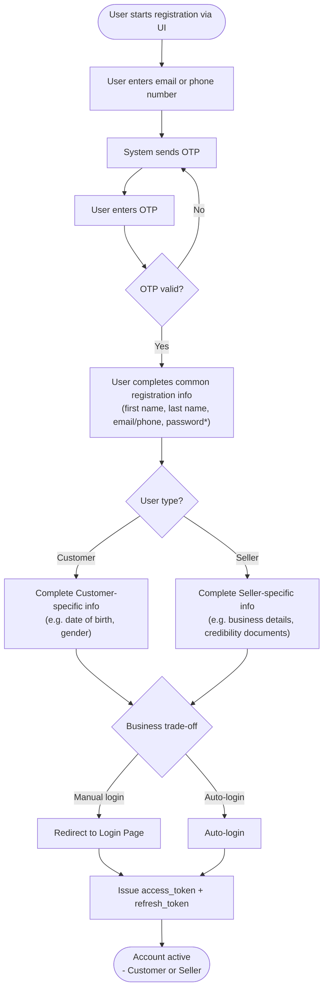
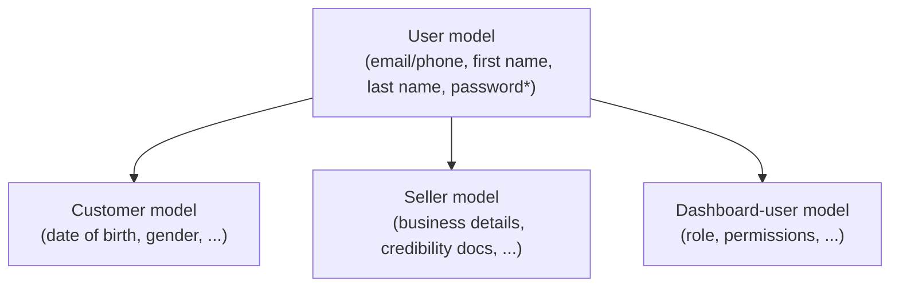

# Registration Documentation

## 1. Registration Methods

The app registration process supports **two methods**:

1. **UI** — the standard self-service flow used by Customers and Sellers.
2. **Internal service by the system or admin** — accounts created/provisioned internally (e.g. by an admin or backend service), bypassing the public UI flow.

---

## 2. UI Registration Flow (General Steps)

1. **OTP Verification** — Confirms that the provided email address or phone number is valid and actually belongs to the user attempting to create the account.

   > **Why OTP matters:**
   > - Reduces fake accounts
   > - Improves account security
   > - Ensures reliable communication with users

2. **Complete Registration Information** — After OTP is verified, the user proceeds to fill in the remaining registration details.

3. **Access the Account** — The user is either:
   - Redirected to the **Login Page** to confirm access and obtain an `access_token` + `refresh_token`, **or**
   - Passed through an **Auto-login** process where `access_token` + `refresh_token`, are generated at registration api for first time.

   *(This is a business trade-off decision.)*

---

## 3. Registration Flowchart — Customer & Seller (Combined)

All users follow the **same shared steps** (OTP verification + common info) first. The flow only **branches by user type** once the common registration info is complete, then **converges** again at the login/auto-login decision.

> \* Password field only applies in a password-based app.

---

## 4. Passwordless vs. Password-Based App

The system can be designed as one of two app types:

- **Passwordless App** — relies solely on OTP for both registration and authentication.
- **Email/Phone + Password-Based App** — uses OTP only once, at registration, then relies on password for subsequent logins.

---
## 5. Passwordless vs. Password-Based — Comparison

| Aspect | Passwordless App | Email/Phone + Password-Based App |
|---|---|---|
| **Registration — OTP role** | OTP verifies identity, then user goes straight to profile completion | OTP verifies identity at registration only (one-time use) |
| **Password field** | Not required at any stage | Required during registration and stored for future logins |
| **Login (subsequent visits)** | User enters email/phone → receives new OTP → enters OTP → access granted | User enters email/phone + password → access granted |
| **OTP usage frequency** | Every login | Once — only at registration |
| **User friction on login** | Slightly higher (must wait for OTP each time) | Lower (instant, no waiting for a code) |
| **Security dependency** | Relies on user's access to email/phone every time | Relies on password strength + optional MFA |
| **Risk of credential reuse/leak** | Low (no password to leak or reuse) | Higher (passwords can be weak, reused, or leaked) |
| **Infrastructure cost** | Higher — OTP must be sent (SMS/email) on every login | Lower — OTP sent only once, at registration |
| **Best suited for** | Apps prioritizing simplicity and reduced password-related support issues | Apps prioritizing fast repeat logins and offline/limited-connectivity scenarios |

---

## 6. User Data Models

All users in the system share a **common set of registration information**, plus **type-specific information** based on their role.

### 6.1 Common Information (stored in `User` model)
- Email/phone
- First name
- Last name
- Password *(password-based app only)*

### 6.2 Type-Specific Information

| User Type | Stored In | Example Additional Fields | Purpose |
|---|---|---|---|
| Customer | `Customer` model | Date of birth, gender | Power promotional features, improve loyalty, enhance purchasing experience |
| Seller | `Seller` model | Business details, credibility/verification documents | Manage seller–platform relationship, improve service-provider credibility, increase customer trust |
| Dashboard User | `Dashboard-user` model | Role, permissions, department | Manage internal/admin access to the system |

### 6.3 Data Model Structure

### 6.4 Why This Structure?

- Keeps the data structure **organized**
- Avoids unnecessary/unused fields in the main `User` table
- Makes the system **easier to extend** with new user types in the future
